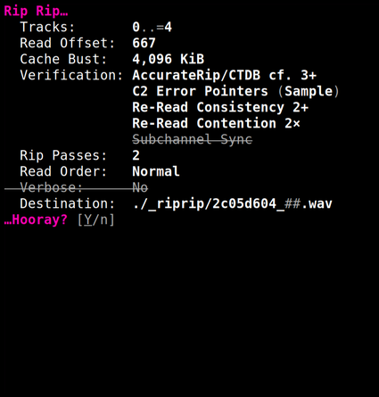
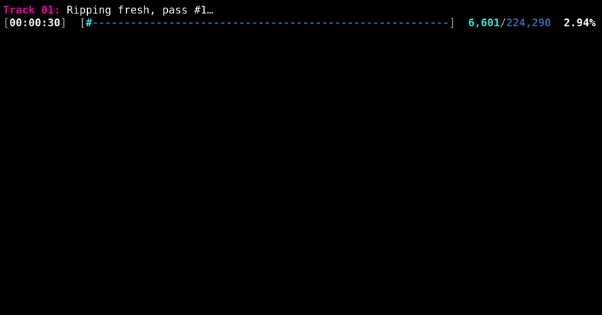

# Rip Rip Hooray!

[](https://github.com/Blobfolio/riprip/actions)
[](https://deps.rs/repo/github/blobfolio/riprip)<br>
[](https://en.wikipedia.org/wiki/WTFPL)
[](https://github.com/Blobfolio/riprip/issues)


Rip Rip Hooray! is a specialized audio CD-ripper for Linux and macOS that is optimized for _track recovery_.

</img> </img>

Rather than beat the drive senseless every time a read error is encountered, it simply notes the problem and moves on. Its iterative design allows it to grab what it can, as it can, progressively filling in the gaps from run-to-run.

Between those (relatively quick) runs, you can actually _do things_. You can inspect the disc, give it another clean, switch drives, shut down your computer and go to bed, or check to see if the rip is already _good enough_ for [CUETools repair](https://cue.tools/wiki/CUETools_Database) to automatically finish up for you.

Total recovery is not always possible — drives can only read what they can read — but Rip Rip Hooray! will rescue more data than traditional CD-ripping software, more accurately, and in significantly less time.


## Features

Iteration is key. Individual Rip Rip rips take minutes intead of hours or days, getting you access to the recovered data — regardless of "completeness" — as quickly as possible. You can re-run Rip Rip at any time, as many times as you want, with as many different optical drives as you want, to retry the outstanding regions and refine the data. You can also abort a rip early without losing your progress.

Beyond that, it supports all the good things:

* C2 error pointers
* Subchannel timecode synchronization
* Drive read offset auto-detection and correction
* [AccurateRip](https://accuraterip.com/) and [CUETools](https://cue.tools/wiki/CUETools_Database) checksum verification
* HTOA (pregap) tracks
* CD-Text and Sub-Q metadata
* Cache busting
* Sample re/confirmation
* Forwards, backwards, and alternating read orders
* Cue sheet generation in both `.cue` and `.toc` formats (whole album rips only)
* Simple, honest `.wav` output

Rip Rip can also be used to summarize a disc's track layout, and calculate and display its various TOC-derived identifiers, including:

* [AccurateRip](https://accuraterip.com/) ID
* [CDDB](https://en.wikipedia.org/wiki/CDDB) ID
* `"CDTOC"` (metatag value)
* [CUETools](https://cue.tools/wiki/CUETools_Database) ID
* [MusicBrainz](https://musicbrainz.org/) ID


## Requirements

Rip Rip Hooray! is a command line application for 64-bit Linux and macOS, though it'll technically run on x64 Windows 11[^1] too if that's all you've got.

It's fully self-contained and has no other runtime dependencies.


### Optical Drive

Because of its focus on _recovery_, Rip Rip Hooray! imposes stricter requirements on optical drives than most CD-ripping software. To work with this program, your drive will need to support:

* Accurate Stream (most modern drives qualify)
* SCSI/MMC 2+ (again, most modern drives qualify)
* C2 Error Pointers

The drive will also need a known [read offset](https://www.accuraterip.com/driveoffsets.htm) to be auto-detected, or you'll need to know and enter the appropriate value using the `-o`/`--offset` option.

If your drive has a read buffer cache that isn't auto-detected, enter its size in **kilobytes** with the `-c`/`--cache` option so Rip Rip can try to mitigate its effects.

Programmatic detection of cache size is unreliable, so Rip Rip maintains its own manual list. To have your drive included, simply open an [issue](https://github.com/Blobfolio/riprip/issues) with your drive's vendor/model string — as displayed by Rip Rip — and a link to a manual/spec page showing the value.


### Disk/RAM

Unlike traditional CD-rippers, Rip Rip Hooray! can't just react to data in realtime and promptly throw it away; it needs to keep track of each individual sample's state and history to progressively work towards a complete rip.

This data is only needed while it's needed — you can delete the `_riprip` subfolder as soon as you've gotten what you wanted to reclaim the space — but is nonetheless hefty, generally about 1-3x the size of the original CD source.

Its peak memory usage is also higher than most other CD-rippers, though it varies based on the length of the longest track being ripped. A few hundred megabytes of RAM will usually suffice, but in worst-case scenarios like the 74-minute single-track album [Delirium Cordia](https://www.allmusic.com/album/delirium-cordia-mw0000693555) by Fantômas, nearly 3GiB will be required!


### Expectations

Rip Rip Hooray! does its best to _mitigate_ drive confusion and inconsistency, but like any other CD-ripping software, it is ultimately dependent on the drive's ability to accurately read the data on the disc, or at least be honest about any inaccuracies.

When a disc's surface is as pocked and cratered as the moon's, or disc rot has started to take hold, chances are some of that data will remain inaccessible, no matter how many times a drive, or multiple drives, attempts to re-read it.

(The unaffiliated) [CUETools](http://cue.tools/wiki/Main_Page)'s repair feature can be instrumental in filling in those final bits. If Rip Rip can't confirm the rips, toss them into CUETools to see if they're _close enough_ for automatic repair. If not, run another Rip Rip pass and try again. Rinse and repeat.

Hopefully with a little back-and-forth, you'll wind up with perfect rips, one way or another!


## Usage

Rip Rip Hooray! is run from the command line, like:

```bash
riprip [OPTIONS]

# To see a list of options, use -h/--help:
riprip --help
```


### Example Recovery Workflow

First things first, rip the entire disc and see what happens!

```bash
# Rip the whole disc!
riprip
```

> [!NOTE]
> Some systems will require you run `sudo riprip`[^2] instead.

Rip Rip will check each track against both the [AccurateRip](https://accuraterip.com/) and [CUETools](https://cue.tools/wiki/CUETools_Database) databases to verify its accuracy, letting you know which were rescued, and which need more work.

If _all_ tracks verify, hooray! You're done!

If not, try opening the generated `.cue` with [CUETools](http://cue.tools/wiki/CUETools) to see if it can automatically "repair" the rip for you. (Linux users can [run CUETools via WINE](https://blobfolio.com/2023/cuetools-wine/).)

If that works, hooray! You're done!

If not, _iterate!_

Simply re-run Rip Rip to refine the results. It will pick up from where it left off, (re)reading any sectors that have room for improvement, skipping the rest.

```bash
# Re-rip!
riprip
```

Same as before, if any problem tracks remain, open up CUETools to see if they're accurate _enough_ for automatic "repair".

Rinse and repeat!

If you know you'll need several more passes to get the data good enough for CUETools, you can automate them with the `-p`/`--passes` option, like:

```bash
# Run through each track up to three times, if needed.
riprip -p3

# Automation also allows for other fun things, like alternating between
# forward and backward traversal:
riprip -p3 --flip-flop
```

Sooner or later, you'll either wind up with everything, or everything the drive can possibly deliver.

There are a number of advanced options that can come in handy for tricky situations, so be sure to take a look at the `--help` screen for inspiration.

Good luck!


### Experimental CTDB repair

```sh
riprip --ctdb-assess
riprip --ctdb-repair --passes 3
```

`--ctdb-assess` reads the inserted disc's TOC and the saved rip states. It reports
available CTDB parity, the distribution of uncertain samples across codewords,
and whether a proposed correction passed CTDB verification. Assessment is
read-only, and drive access is limited to disc identification. It uses the
same confidence threshold as ripping (`--confidence`, default 3).

`--ctdb-repair` checks a complete saved rip before reading again, then checks
newly saved evidence after each physical pass. A verified repair skips further
reads of the covered audio. Subsequent passes can still read an uncertain,
reachable guard window or hidden track-one audio. Failed checks leave the
physical passes scheduled. Lookup and parity data are reused during the rip.
The repair can use saved states from earlier sessions and other drives, and
agreeing read-ahead samples at track boundaries.
Successful repairs update the affected WAVs at their normal `_riprip/`
paths. Rip Rip stages every replacement before installing any of them and
keeps temporary backups for rollback if installation fails. The original
drive observations stay in the recovery files for subsequent physical rereads.
During resume, Rip Rip keeps verified WAVs while their fingerprints match,
until the physical audio independently verifies or a new CTDB repair succeeds.

#### Format and verification

Rip Rip uses `cdtoc` to parse CTDB v3 lookups and their cached responses.
Supported entries advertise 8 or 16 syndrome rows. Rip Rip downloads the
little-endian parity over HTTPS and checks its first lane against the lookup
syndrome before decoding.
[CTDB overview](https://cue.tools/wiki/CTDB)
[CUETools lookup client](https://github.com/gchudov/cuetools.net/blob/master/CUETools.CTDB/CUEToolsDB.cs)
[Syndrome serialization](https://github.com/gchudov/cuetools.net/blob/master/CUETools.Parity/Parity2Syndrome.cs)

CTDB uses a stride of 5,880 stereo frames. Each left or right 16-bit word
belongs to one of 11,760 interleaved Reed–Solomon codewords over GF(2¹⁶),
with primitive polynomial `0x1100B`. For an audio image of `D` frames and
stride `W`, the zero-offset window starts at `W` and contains
`(floor(D / W) - 2) * W` frames. The decoder checks alignments from −5,879
through +5,879 stereo frames. It writes repairs at the original local sample
positions, using the drive-corrected coordinates already stored by Rip Rip.
Compatible references have the same audio track lengths as the disc. Track
CRCs use those boundaries within the protected audio window.
[CUETools interleave and offset behavior](https://github.com/gchudov/cuetools.net/blob/master/CUETools.AccurateRip/CDRepair.cs)
[CUETools track CRC behavior](https://github.com/gchudov/cuetools.net/blob/master/CUETools.AccurateRip/AccurateRip.cs)

For each codeword with `p` syndrome rows, the guaranteed decoding bound is
`2 * unknown_errors + known_erasures <= p`. A contiguous burst and the same
number of errors separated by whole strides can put very different loads on
the codewords. Assessment shows the peak load and how many codewords exceed
the bound under different assumptions. C2 and unread positions are candidate
erasures, and weak reads can provide additional location hints. The decoder
combines the local and reference syndromes, removes the known erasure terms
for Berlekamp–Massey, searches the shortened codeword for roots, and solves a
Vandermonde system for the correction magnitudes. It checks every syndrome
before proposing a correction. Acceptance requires the disc CRC and every
available, applicable track CRC for the record. Corrections also preserve PCM
protected by the existing AccurateRip or CTDB checks.
[Reed–Solomon finite-field specification](https://www.rfc-editor.org/rfc/rfc5510)
[Errors-and-erasures decoding](https://ntrs.nasa.gov/api/citations/19890010958/downloads/19890010958.pdf)

CTDB coverage excludes hidden track-one audio and the data session of an Enhanced
CD. The leading and trailing guard windows are excluded at the verified
pressing offset. The trailing window includes the remainder after division by
5,880. Assessment reports uncertain frames outside coverage when present. A
record with different audio track lengths or an unsupported stride cannot be
used. Assessment and repair hold one disc PCM image and its quality data in
memory and load one track's saved state at a time.

The Rust decoder was written independently from the finite-field and
Reed–Solomon mathematics. The CUETools code was used to identify interoperable
record fields, sample positions, and checksum coverage. Rip Rip and its existing
`cdtoc` dependency use the WTFPL.

#### Repair tests

The regular test suite uses deterministic PCM and an independent reference
syndrome generator. It covers isolated and distributed errors, a sector and
bursts, crossing track boundaries, both offset signs, mixed errors and
erasures, misleading C2 flags, exact and exceeded capacity, preservation of
protected samples, conflicting offset repairs, and rejection of incorrect CRCs.

The physical fixture is the 11-track Enhanced CD with CTDB TOCID
`L7S9zvGxE.4JzQLS4Yh67L6..ZM-` and recovery record `90691`. Its
128,209,284 stereo frames matched AccurateRip and CTDB. Injected damage
combining a complete sector, a three-sector burst, distributed and
track-boundary errors, and lanes at the 16-row correction limit was restored
byte for byte using the live parity. With seventeen erasures in one
codeword, the decoder rejected the damaged copy. The ignored test reads the
local fixture from `RIPRIP_CTDB_DISC_FIXTURE`, with the WAVs in `_riprip/` and
the CTDB parity at `90691.syndrome`.

A Windows CLI assessment preserved the SHA-256 hashes of all 13 files in
the test workspace. The in-place export test uses that saved audio and
parity and injects 589 changed channel words into a track state. It checks
the normal WAV paths against the original rip byte for byte. It also checks
that the drive observations are preserved and a later unverified resume
retains the repaired WAV.

### Debugging and Troubleshooting.

If a disc is giving you trouble or you simply want a record of the proceedings, set the `-v`/`--verbose` flag to have Rip Rip emit a log to STDOUT.

```bash
# The normal interface uses STDERR, so to keep the two from getting tangled,
# redirect the log to e.g. a file:
riprip -v > my-rip.log

# For additional information, set -v twice.
riprip -v -v > my-rip.log
```

If you're experiencing issues with the drive or Rip Rip itself, another `-v` or two can help with debugging:

```bash
# Trace-level reporting gives more information about what is failing
# and where.
riprip -v -v -v > my-rip.log

# Trace-Premium-Plus™ gives context to the context, enumerating the
# specific values, settings, etc., in play at the moment of failure.
riprip -v -v -v -v > my-rip.log
```

Optical drives and drivers are weird, so please don't hesitate to open an [issue](https://github.com/Blobfolio/riprip/issues/new) if something's not working right!


## Installation

Debian and Ubuntu users can grab the x86-64-v3 `.deb` package attached to the [latest release](https://github.com/Blobfolio/riprip/releases/latest), and Arch Linux users can install the same through [AUR](https://aur.archlinux.org/packages/riprip-bin) (thanks @Dominiquini!).

(Homebrew integration for macOS is [coming soon](https://github.com/Blobfolio/riprip/issues/18).)

To get Rip Rip up and running on other supported systems, it just needs to be built from source.

There are a few pre-requisites, but unless this is the first package you've ever tried to build, you probably already have them:

* [Rust](https://rustup.rs/) (latest stable)
* `clang` or `gcc` (Linux), `Xcode` (macOS)[^3], `MSVC` (Windows)
* [`CMake`](https://github.com/aws/aws-lc-rs/blob/main/aws-lc-sys/CMakeLists.txt#L4C32-L4C42)

> [!NOTE]
> Some systems might also need `NASM`, but you can probably skip it unless you get a build error.

Once you've got those things squared away, a single command'll do the trick:

```bash
# Make sure Rust is up-to-date.
rustup update stable

# See "cargo install --help" for more options.
cargo install \
    --git https://github.com/Blobfolio/riprip.git \
    --bin riprip

# Hooray?
riprip --version
```

If you run into any issues or would like to help make Rip Rip available on more platforms, [let us know](https://github.com/Blobfolio/riprip/issues/new)!


### Offline/Vendored Builds

If your build environment lacks networking support, pre-download the `Source code (tar.gz)` and `vendored-sources.tar.zst` assets attached to the [release](https://github.com/Blobfolio/riprip/releases/latest), then:

```bash
# Extract the source code.
tar -xf riprip-VERSION.tar.gz

# Move into the source root.
cd riprip-VERSION

# Extract the vendored sources (into the source root).
tar -xf ../vendored-sources.tar.zst

# Build! See `cargo build --help` for more options.
cargo build \
    --release \
    --locked \
    --offline

# Hooray?
./target/release/riprip --version
```


[^1]: The Windows Command Line Experience™ frankly sucks. Haha.
[^2]: To enable "sudo" on Windows, see [here](https://learn.microsoft.com/en-us/windows/advanced-settings/sudo/).
[^3]: To install Xcode, run: `xcode-select --install`
